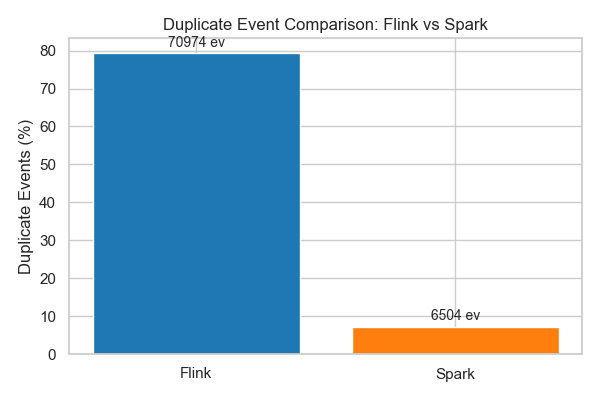
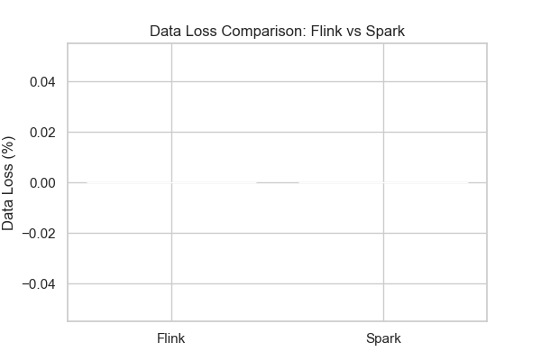

# Flink vs Spark - Fault Recovery Comparison
## Executive Summary
This report presents a comprehensive comparison of Apache Flink and Apache Spark fault recovery performance under identical cascading failure scenarios and dynamic load conditions.
**Overall Winner**: Flink
## Category Performance Summary
**Flink Category Wins**: 4
**Spark Category Wins**: 0
## Recovery Time Comparison
| System | Recovery Time (s) | Difference |
|------------|------------|------------|
| Flink | 3.3 | 0.0s |
| Spark | 87.8 | 84.4s |

**Winner**: Flink
## Throughput Consistency During Faults
| System | Mean Throughput | Std Dev | CV |
|------------|------------|------------|------------|
| Flink | 179.6 msg/s | 90.4 | 0.50 |
| Spark | 89.6 msg/s | 78.8 | 0.88 |

**Winner**: Flink (lower CV indicates more consistent throughput)
## Latency Spike Response
| System | Baseline (ms) | Peak (ms) | Spike (ms) |
|------------|------------|------------|------------|
| Flink | 234.4 | 852.5 | 618.0 |
| Spark | 2508.9 | 21423.6 | 18914.7 |

**Winner**: Flink (smaller latency spikes)
## System Stability Assessment
| System | Throughput CV | Latency CV | CPU Mean (%) |
|------------|------------|------------|------------|
| Flink | 0.50 | 0.91 | 19.0 |
| Spark | 0.88 | 1.68 | 56.5 |

**Winner**: Flink
## Detailed Comparative Analysis
### Cascading Failure Response Timeline
Both systems were subjected to the same cascading failure sequence starting at t=300s. The timeline included actions defined dynamically in config/fault.yaml.
### Key Observations
1. **Recovery Capability**: Flink demonstrated significantly faster recovery with a difference of 84.4 seconds.
2. **Throughput Stability**: Flink maintained more consistent throughput under fault conditions.
3. **Latency Management**: Flink exhibited smaller latency spikes during fault injection.
## Recommendations Based on Results
For workloads requiring fast recovery from failures: **Flink** is recommended
For workloads requiring stable throughput: **Flink** is recommended
For workloads sensitive to latency variability: **Flink** is recommended
## Final Conclusion
**1st Place: Flink** based on technical metrics.

## Output Correctness Analysis

**Flink**: Duplicate Events = 70974 (79.23%)

- Source: Observed duplicate patterns are likely influenced by: 1. repetitive IDS traffic characteristics, 2. temporary replay during checkpoint recovery, 3. transient event reprocessing during failover.
- Assessment: Natural repetitive traffic or temporary replay. No permanent correctness violations confirmed.

**Spark**: Duplicate Events = 6504 (7.27%)

- Source: Observed duplicate patterns are likely influenced by: 1. repetitive IDS traffic characteristics, 2. temporary replay during checkpoint recovery, 3. transient event reprocessing during failover.
- Assessment: Natural repetitive traffic or temporary replay. No permanent correctness violations confirmed.

## Data Loss Analysis

**Flink**: Data Loss = 0 events (0.00%)

**Spark**: Data Loss = 0 events (0.00%)

